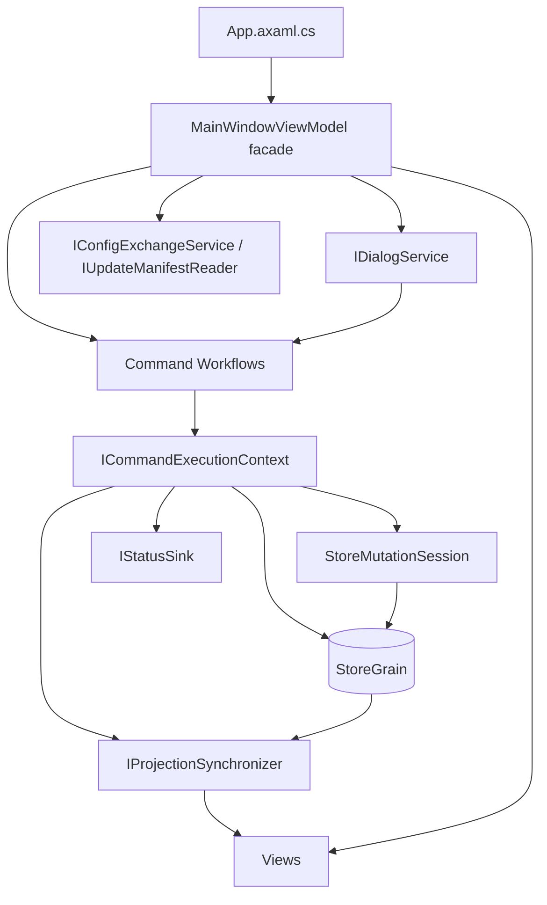

# WT Launcher 重新布线生产蓝图

> 状态：Production-ready blueprint v1，Phase A-E 已全量落地（2026-08-15）
> 上游：`docs/wiring-rewiring-plan.md`
> 范围：全量接线契约化；实现已按 Phase A-E 落地，`docs/wiring-map.md` 为端口台账

## 1. 生产定义（DoD）

1. 蓝图中的每个接口、文件、迁移阶段都可直接交给实现者执行。
2. 每个 workflow 都有明确职责、依赖、返回类型、测试文件和门禁规则。
3. MainWindowViewModel 行预算有可测量基线：`MainWindowViewModel*.cs` 总和 <= 1200。
4. `docs/wiring-map.md` 成为端口台账唯一文档源，并由门禁校验。
5. 蓝图本身保持 `git diff --check` 与 `tools/verify.ps1` 全绿。

## 2. 目标拓扑



## 3. Phase A 端口契约

### 3.1 IStatusSink

文件：`src/avalonia-launcher/src/WTLauncher.App/ViewModels/IStatusSink.cs`

```csharp
public interface IStatusSink
{
    void Apply(LauncherStatusContent status);
    void SetDryRunText(string text);
}
```

MainWindowViewModel 实现时转发到 `_statusPresenter` 或现有状态属性，不持有第二份状态。

### 3.2 ICommandExecutionContext

文件：`src/avalonia-launcher/src/WTLauncher.App/ViewModels/ICommandExecutionContext.cs`

```csharp
public interface ICommandExecutionContext : IProjectionSynchronizer
{
    StoreGrain Store { get; }
    IStatusSink Status { get; }
    string GetTimestampUtc();
}
```

规则：

- `Store` 直接暴露 `StoreGrain`，不新增薄 `IStoreGateway`。
- `Status` 只负责状态文本与 DryRun 回执。
- `IProjectionSynchronizer` 是 workflow 唯一的投影重建入口。
- workflow 禁止接收 `MainWindowViewModel` 或 `Func<...>`/`Action<...>` 回调包。

### 3.3 ILaunchCoordinatorContext 继承关系

```csharp
public interface ILaunchCoordinatorContext : ICommandExecutionContext
{
    LauncherSettings GetSettings();
    void DiscardDragReorderPreview();
    bool PersistSettings(Func<LauncherSettings, LauncherSettings> mutator, LauncherStatusContent? successStatus);
    IEnumerable<LauncherEntryViewModel> GetEntries();
    LaunchSaveResult SaveConfig(LaunchSaveResultKind kind);
    void RecordRunHistory(IReadOnlyList<LauncherRunHistoryEntry> entries);
}
```

重复成员从 `ILaunchCoordinatorContext` 中删除：`GetTimestampUtc`、`SetDryRunText`、`ApplyStatus`、`SynchronizeProjections` 由基接口提供。

## 4. 命令面迁移矩阵

| 当前文件 | 当前方法 | 目标 workflow | 目标方法 |
|----------|----------|---------------|----------|
| MainWindowViewModel.Entries.cs | AddEntryAsync/CloneEntryAsync/EditEntryAsync/DeleteEntryAsync | LauncherEntryCommandWorkflow | AddAsync/CloneAsync/EditAsync/DeleteAsync |
| MainWindowViewModel.Presets.cs | ApplyPreset/LaunchSelectedPreset/PreviewSelectedPreset/SaveSelectionAsPreset/UpdateSelectedPreset/DeleteSelectedPreset | LauncherPresetCommandWorkflow | ApplyAsync/LaunchAsync/PreviewAsync/SaveAsync/UpdateAsync/DeleteAsync |
| MainWindowViewModel.Layout.cs | OnLayout* / RecordSearchTerm / TrySaveWindowBounds | LauncherLayoutCommandWorkflow | ApplyFilterAsync/ApplySortAsync/ApplyViewModeAsync/ApplyGroupKeyAsync/RecordSearchAsync/SaveWindowBoundsAsync |
| MainWindowViewModel.Batch.cs | SelectVisible/ClearSelection/ClearVisibleSelection/LaunchSelectedAsync | LauncherSelectionCommandWorkflow | SelectVisibleAsync/ClearAsync/ClearVisibleAsync/LaunchSelectedAsync |
| MainWindowViewModel.CommandManagement.cs | OpenCommandManagementAsync/ApplyCommandManagementEdit | LauncherMaintenanceCommandWorkflow | OpenCommandManagementAsync/ApplyCommandEditAsync |
| MainWindowViewModel.DirectoryManagement.cs | OpenDirectoryManagementAsync/ApplyDirectoryManagementEdit | LauncherMaintenanceCommandWorkflow | OpenDirectoryManagementAsync/ApplyDirectoryEditAsync |
| MainWindowViewModel.Migration.cs | Export*/ImportConfigAsync | LauncherExchangeCommandWorkflow | ExportAsync/ImportAsync |
| MainWindowViewModel.Update.cs | CheckForUpdatesAsync | LauncherExchangeCommandWorkflow | CheckForUpdatesAsync |
| LaunchOrchestrator.cs | 单启/批启/取消/预演 | 保留为 LaunchOrchestrator | 保持现有方法 |

## 5. 文件变更清单

### Phase A：上下文与端口

新增：

- `ViewModels/IStatusSink.cs`
- `ViewModels/ICommandExecutionContext.cs`
- `tests/ViewModelBehavior/ICommandExecutionContextTests.cs`

修改：

- `ViewModels/LaunchOrchestrator.cs`：`ILaunchCoordinatorContext` 继承新基接口
- `ViewModels/MainWindowViewModel.cs`：实现 `ICommandExecutionContext`

### Phase B：Preset 与 Layout

新增：

- `ViewModels/Commands/LauncherPresetCommandWorkflow.cs`
- `ViewModels/Commands/LauncherLayoutCommandWorkflow.cs`
- `tests/ViewModelBehavior/LauncherPresetCommandWorkflowTests.cs`
- `tests/ViewModelBehavior/LauncherLayoutCommandWorkflowTests.cs`

修改：

- `MainWindowViewModel.Presets.cs`：命令体迁出，保留命令与 CanExecute
- `MainWindowViewModel.Layout.cs`：状态持久化迁出，保留 LayoutManager 投影
- `ViewModels/PresetManager.cs`：如需要暴露 workflow 所需窄端口

### Phase C：Selection、Maintenance、Entry

新增：

- `ViewModels/Commands/LauncherSelectionCommandWorkflow.cs`
- `ViewModels/Commands/LauncherMaintenanceCommandWorkflow.cs`
- `ViewModels/Commands/LauncherEntryCommandWorkflow.cs`
- 对应三个测试文件

修改：

- `MainWindowViewModel.Batch.cs`
- `MainWindowViewModel.CommandManagement.cs`
- `MainWindowViewModel.DirectoryManagement.cs`
- `MainWindowViewModel.Entries.cs`
- `MainWindowViewModel.Discovery.cs`

### Phase D：Exchange

新增：

- `ViewModels/Commands/LauncherExchangeCommandWorkflow.cs`
- `tests/ViewModelBehavior/LauncherExchangeCommandWorkflowTests.cs`

修改：

- `MainWindowViewModel.Migration.cs`
- `MainWindowViewModel.Update.cs`
- `ViewModels/ImportConfigViewModel.cs`（如只读快照依赖保持现状）

### Phase E：wiring-map 台账与门禁

新增：

- `docs/wiring-map.md`
- `tools/wiring-map-consistency.ps1` 或 `tools/verify.ps1` 内嵌检查

修改：

- `tools/verify.ps1`：Add-Check `wiring-map-consistency`、`main-vm-line-budget`、`workflow-no-callback-bag`
- `AGENTS.md`：结构基线门禁数 40 -> 43
- `CLAUDE.md`、README、docs 复核注记同步

## 6. Workflow 规格

### 6.1 LauncherEntryCommandWorkflow

- 依赖：`ICommandExecutionContext`、`IEntryService`、`IDialogService`、`IEntryCollection`
- 职责：新增、克隆、编辑、删除、修复目录、发现结果落库
- 返回值：`Task<EntryCommandResult>`，含 `StatusMessage`、`StoreFile`、`EntryId?`
- 边界：不持有 ObservableCollection；通过 `IEntryCollection` 端口通知 VM 替换条目

### 6.2 LauncherPresetCommandWorkflow

- 依赖：`ICommandExecutionContext`、`IPresetService`、`IDialogService`、`IEntryCollection`、`LaunchOrchestrator`
- 职责：apply、启动决策、预览、CRUD、选择预览、引用校验
- 返回值：`Task<PresetCommandResult>`
- 边界：`LaunchOrchestrator` 仍是唯一启动执行者

### 6.3 LauncherLayoutCommandWorkflow

- 依赖：`ICommandExecutionContext`、`LayoutManager`
- 职责：筛选、排序、视图模式、分组、搜索历史、窗口边界持久化
- 返回值：`Task<LayoutCommandResult>`
- 边界：`LayoutManager` 仍是单一只读投影 owner

### 6.4 LauncherSelectionCommandWorkflow

- 依赖：`ICommandExecutionContext`、`IEntryCollection`、`PresetManager`、`LaunchOrchestrator`
- 职责：两条选择写入路径、批量保存、恢复、批量启动委托
- 返回值：`Task<SelectionCommandResult>`
- 边界：不新增全局 bulk suppression flag

### 6.5 LauncherMaintenanceCommandWorkflow

- 依赖：`ICommandExecutionContext`、`IDialogService`、`IEntryCollection`、`ICommandEditApplier`、`IDirectoryEditApplier`
- 职责：命令/模板批量编辑、地址 rename/merge/delete、单次 Commit
- 返回值：`MaintenanceCommandResult`
- 边界：Dialog 只发 edit，不持 store

### 6.6 LauncherExchangeCommandWorkflow

- 依赖：`ICommandExecutionContext`、`IConfigExchangeService`、`IUpdateManifestReader`、`IDialogService`
- 职责：导入导出、更新检查、ApplyStoreFileToVm 编排
- 返回值：`Task<ExchangeCommandResult>`
- 边界：外部文件 IO 与规范 store 事务分离

## 7. 状态与数据所有权

| 状态 | Owner | Workflow 如何访问 |
|------|-------|------------------|
| StoreGrain | StoreGrain | `ICommandExecutionContext.Store` |
| 可绑定集合 | MainWindowViewModel | `IEntryCollection` 端口 |
| PresetManager | MainWindowViewModel | `LauncherPresetCommandWorkflow` 通过端口读取/回调 |
| LayoutManager | MainWindowViewModel | `LauncherLayoutCommandWorkflow` 注入 |
| StatusPresenter | MainWindowViewModel | `IStatusSink` |
| 选择态 | Entry VM owner setter | `LauncherSelectionCommandWorkflow` 调用 owner setter |
| RunHistory | MainWindowViewModel | `LaunchOrchestrator` 经 `ILaunchCoordinatorContext` |

## 8. 测试计划

### 8.1 新增测试

- `ICommandExecutionContextTests.cs`：Store/Status/Projections 端口返回与空值规则
- `LauncherPresetCommandWorkflowTests.cs`：apply/launch/preview/save/update/delete 成功与回滚
- `LauncherLayoutCommandWorkflowTests.cs`：五种布局变更、搜索历史、窗口边界保存失败回滚
- `LauncherSelectionCommandWorkflowTests.cs`：两条写入路径、批量保存一次、失败恢复
- `LauncherMaintenanceCommandWorkflowTests.cs`：命令/模板/目录 edit 单次 Commit、失败恢复、同值 no-op
- `LauncherExchangeCommandWorkflowTests.cs`：导入导出成功/失败/取消，外部 IO fake 不碰真实路径

### 8.2 既有测试迁移

- `MainWindowViewModelTests.PresetTests.cs` / `PresetManagementTests.cs`：保持黑盒，不重写
- `MainWindowViewModelTests.FilterTests.cs` / `SelectionTests.cs` / `CommandManagementTests.cs` / `DirectoryManagementTests.cs`：保持黑盒，验证命令面仍工作
- 所有测试继续通过 `MainWindowViewModel` 公共命令面调用，不直接依赖 private 方法

### 8.3 验收数字

- `dotnet test` >= 820，最终应随新 workflow 测试增加
- 门禁 checks 40 -> 43
- ViewModels 文件数 54 -> 61（新增 7 个 workflow/port 文件，视拆文件方式浮动）

## 9. 门禁规则

### 9.1 wiring-map-consistency

- `docs/wiring-map.md` 是端口台账唯一文档源
- 每个新增端口必须出现在台账
- 每个 workflow 类必须列出依赖端口
- 门禁解析源码接口名与台账条目，缺失即失败

### 9.2 main-vm-line-budget

- 对 `MainWindowViewModel*.cs` 按行求和
- 当前约 2500 行，Phase C 后 <= 1800，Phase D 后 <= 1200
- 失败输出超标文件行数，不自动改码

### 9.3 workflow-no-callback-bag

- workflow 构造参数禁止出现 `MainWindowViewModel`
- 禁止 `Func<...>` / `Action<...>` 参数，除 `Func<DateTimeOffset>` 时间端口外
- `ILaunchCoordinatorContext` 维持窄上下文，不随 workflow 扩容

## 10. 迁移顺序与退出标准

| 阶段 | 动作 | 退出标准 |
|------|------|----------|
| Phase A | 新增端口，调整 ILaunchCoordinatorContext | 构建 0 警告，820 测试全绿 |
| Phase B | 迁 Preset、Layout | MainWindowViewModel 行数降 600+，Preset/Layout 新测试全绿 |
| Phase C | 迁 Selection、Maintenance、Entry | MainWindowViewModel 总行数 <= 1800 |
| Phase D | 迁 Exchange、Update | MainWindowViewModel 总行数 <= 1200 |
| Phase E | wiring-map 台账与三条门禁 | 门禁 43 项全绿，结构基线同步 |

## 11. 风险与回滚

- 回调包膨胀：`ICommandExecutionContext` 超过 8 个成员即视为坏味道，先拆端口再继续。
- 行预算被“拆文件”作弊：门禁按文件名统计，禁止通过新建 partial 逃避。
- 行为漂移：每阶段只做“命令体迁出”，不改业务规则；黑盒测试是回归基线。
- 数据风险：本次无 schema/持久化格式变更，config/launcher.json 不迁移。
- 回滚：每阶段独立提交，任一阶段未过门禁即 `git revert` 该阶段 commit，不叠加修复。

## 12. 验证命令

```powershell
git diff --check
dotnet build src/avalonia-launcher/WTLauncher.Avalonia.sln -c Release --no-restore -warnaserror --nologo
dotnet test src/avalonia-launcher/WTLauncher.Avalonia.sln -c Release --no-restore --nologo
powershell -NoProfile -ExecutionPolicy Bypass -File .\tools\verify.ps1
powershell -NoProfile -ExecutionPolicy Bypass -File .\.trellis\tasks\08-15-docs\post-rewrite-check.ps1
```

## 13. 待实现者决策点

- `IEntryCollection` 端口精确方法签名：在 Phase A 代码评审时冻结。
- `LauncherPresetCommandWorkflow` 是否持有 PresetManager：默认不持有，通过窄端口读取。
- 新 workflow 文件放在 `ViewModels/Commands/` 还是 `Features/Commands/`：默认 `ViewModels/Commands/`，与 LaunchOrchestrator 同层。
