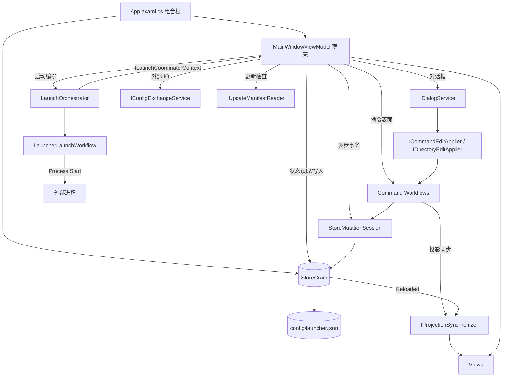
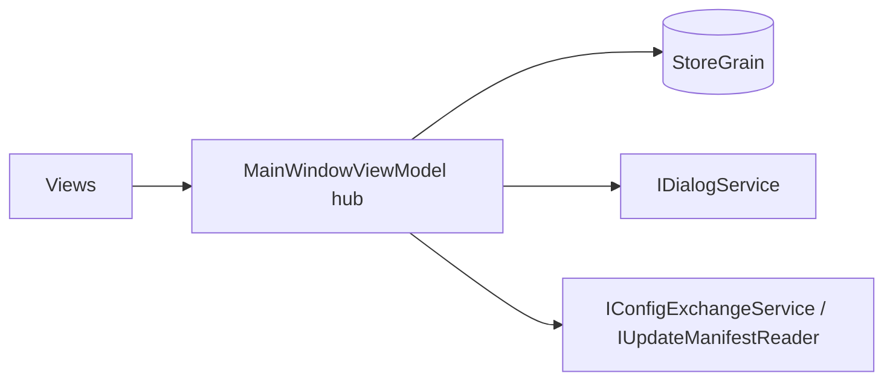
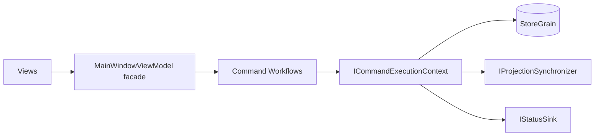

# 重新布线图：WT Launcher 目标接线拓扑

> 状态：规划已定稿
> 生产蓝图：`docs/wiring-rewiring-production-blueprint.md`
> 授权：最高布线和接线权限
> 对齐：5 层架构 + StoreGrain 单一状态源 + 显式端口 + 无服务定位器

## 0. 术语映射

- 拓扑：系统的抽象形状，节点与依赖方向。
- 布线：路径规划，命令和数据“应该走哪条路”，边界画在哪。
- 接线：实际绑定，接口由谁实现、谁被注入、谁被调用。
- 本蓝图用六词描述设计：拓扑、契约、状态、数据、路径、验证。

## 1. 现状诊断

当前 MainWindowViewModel 仍承担大量命令编排：

| 文件 | 行数 | 主要职责 |
|------|------|----------|
| MainWindowViewModel.cs | 511 | 状态聚合、StoreGrain、通用命令、投影同步 |
| MainWindowViewModel.Presets.cs | 446 | Preset CRUD/apply/preview/launch |
| MainWindowViewModel.Layout.cs | 226 | 筛选/排序/视图/分组/搜索历史 |
| MainWindowViewModel.CommandManagement.cs | 204 | 命令与模板管理 |
| MainWindowViewModel.Batch.cs | 199 | 批量选择/启动/确认 |
| MainWindowViewModel.Drag.cs | 162 | 拖拽状态机桥接 |
| MainWindowViewModel.DirectoryManagement.cs | 117 | 地址批量维护 |
| MainWindowViewModel.Discovery.cs | 122 | 工具发现 |
| MainWindowViewModel.Grouping.cs | 113 | 卡片分组投影 |
| MainWindowViewModel.Migration.cs | 112 | 导入导出 |

问题：partial 只是物理切文件，不是接线边界；MainWindowViewModel 仍是“所有命令的默认落点”。

## 2. 目标布线原则

1. MainWindowViewModel 保留：可绑定状态、命令表面、投影所有权。
2. 命令体下沉到有真实行为的 workflow，禁止只转发一个方法的薄包装。
3. 组合根保持显式 new 接线，不引入服务定位器或 DI 容器。
4. 所有状态写入仍经过 StoreGrain；多步 mutation 使用 StoreMutationSession。
5. 投影刷新仍只走 IProjectionSynchronizer 的三种模式。
6. 外部副作用端口保持显式：IConfigExchangeService、IUpdateManifestReader、IEntryDraftValidator。
7. 保留两条选择写入路径，不增加全局批量抑制开关。

## 3. 目标接线图



## 3.1 当前拓扑 → 目标拓扑

当前：MainWindowViewModel 是中心 hub，Views、Dialog、StoreGrain、外部 IO 都直接指向它，所有命令体落在这里。



目标：MainWindowViewModel 变成 facade，命令体落到 workflow；StoreGrain 仍是状态中心，但不再是所有命令的直接目标。



## 3.2 要拆除的接线

| 当前接线 | 问题 | 目标接线 |
|----------|------|----------|
| MainWindowViewModel.Presets.cs 直接执行 CRUD/apply/launch 命令体 | 446 行命令体留在 shell | PresetCommandWorkflow 承载事务 |
| MainWindowViewModel.Layout.cs 保存后直接重建投影 | 布局命令与投影刷新耦合 | LayoutWorkflow 通过 context 提交并同步 |
| MainWindowViewModel.Batch.cs 同时处理选择和启动 | 两条选择写入路径和启动决策混在一起 | SelectionWorkflow 管选择，LaunchOrchestrator 管启动 |
| MainWindowViewModel.CommandManagement.cs 内层/外层保存历史 | 双保存风险 | StoreMutationSession 单次 Commit |
| MainWindowViewModel.Migration.cs 直接调 IConfigExchangeService | 外部 IO 编排仍在 shell | ExchangeWorkflow 承载导入导出 |

## 4. 目标 Command Workflow 拆解

不再按 partial 文件切，而是按业务事务切：

| Workflow | 取代/承载 | 必须拥有的真实行为 |
|----------|-----------|--------------------|
| LauncherEntryWorkflow | Entries.cs / Discovery.cs 的条目落库部分 | draft 校验、ID/顺序同步、单次保存、失败恢复 |
| LauncherPresetWorkflow | Presets.cs 的命令体 | preset 引用校验、apply 选择、CRUD、预览、启动决策 |
| LauncherLayoutWorkflow | Layout.cs / Grouping.cs | 布局状态持久化、分组重建、搜索历史、回滚 |
| LauncherSelectionWorkflow | Batch.cs 的选择部分 | 两条选择写入路径、批量保存、恢复 |
| LauncherMaintenanceWorkflow | CommandManagement.cs / DirectoryManagement.cs | 命令/模板批量编辑、目录批量 rename/merge/delete、单次 Commit |
| LauncherExchangeWorkflow | Migration.cs / Update.cs | 导入导出决策、更新检查编排 |
| LaunchOrchestrator | 既有 | 单启/批启/取消/预演、历史、LaunchSaveResult |

这些 workflow 通过显式上下文端口取得 StoreGrain、投影同步、状态与时间，不回调 MainWindowViewModel 的方法包。

## 5. 迁移阶段

### Phase 0：锁定六词设计语言

| 词 | 本蓝图对应物 |
|----|--------------|
| 拓扑 | 5 层架构 + MainWindowViewModel 从中心 hub 变为 facade |
| 契约 | ICommandExecutionContext、现有端口、workflow 公共方法签名 |
| 状态 | StoreGrain 单一 owner、StoreMutationSession、两条选择写入路径 |
| 数据 | config/launcher.json、导入导出外部文件 |
| 路径 | 命令 -> workflow -> StoreMutationSession -> StoreGrain -> 投影同步 |
| 验证 | workflow 独立测试、门禁 wiring-map-consistency、MainWindowViewModel 行预算 |

### Phase A：定义 CommandExecutionContext

- 新增窄上下文端口，不创建新状态网关：

```csharp
public interface ICommandExecutionContext
{
    StoreGrain Store { get; }
    IProjectionSynchronizer Projections { get; }
    IStatusSink Status { get; }
    DateTimeOffset GetTimestampUtc();
}
```

- `StoreGrain` 直接暴露为状态网关，不包一层薄 `IStoreGateway`，避免撞 `no-thin-wrapper-delegation`。
- `IStatusSink` 只负责状态文本和回执，不持有业务状态。
- `Projections` 只允许三种模式：VisibleOnly、Mutation、FullReload。
- MainWindowViewModel 实现该上下文，但 workflow 只依赖接口。
- 验收：MainWindowViewModel 中不再出现“取状态 → 改状态 → 保存 → 刷新”的重复骨架。


### Phase A：定义 CommandExecutionContext

- 新增 `ICommandExecutionContext`：StoreMutationSession、StoreGrain 只读/写端口、IProjectionSynchronizer、StatusContent、GetTimestampUtc。
- MainWindowViewModel 实现该上下文，但 workflow 只依赖接口。
- 验收：MainWindowViewModel 中不再出现“取状态 → 改状态 → 保存 → 刷新”的重复骨架。

### Phase B：先提取最高风险 Preset 与 Layout

- 将 Presets.cs 和 Layout.cs 的真实事务迁入两个 workflow。
- 保留命令表面在 MainWindowViewModel，命令体不再直接写 store。
- 验收：Preset/Layout 相关测试全绿；MainWindowViewModel 总行数下降 600+。

### Phase C：提取 Maintenance、Selection、Entry

- 命令/地址管理统一走 StoreMutationSession 单次 Commit。
- Entry/Discovery 只保留“编排入口”，落库事务下沉。
- 验收：MainWindowViewModel 总行数降至 1200 以下。

### Phase D：外部 IO 与启动统一

- Migration/Update 的命令体迁入 LauncherExchangeWorkflow。
- LaunchOrchestrator 已是端口化范例，只补 context 统一。
- 验收：MainWindowViewModel 不再直接触碰 IConfigExchangeService/IUpdateManifestReader。

### Phase E：接线图机器化

- 将本蓝图沉淀为 `docs/wiring-map.md` 唯一端口台账。
- verify.ps1 新增 `wiring-map-consistency`、`main-vm-line-budget`、`workflow-no-callback-bag` 三条检查。
- 验收：门禁从 40 项升到 43 项；结构基线同步。

## 6. 禁止事项

- 不引入服务定位器、DI 容器或全局 EventBus。
- 不新增第二个状态 owner。
- 不把 workflow 做成“转发 MainWindowViewModel 方法”的薄壳。
- 不删除两条选择写入路径。
- 不把外部 IO 或启动副作用放进 Views。
- 不绕过 StoreGrain 写规范配置。

## 7. 最终验收

- `dotnet build -warnaserror` 0 警告。
- `dotnet test` 820+ 全绿。
- `tools/verify.ps1` 全绿，含新增 wiring-map 检查。
- `git diff --check` 干净。
- MainWindowViewModel 总行数低于 1200。
- 每个 workflow 有独立测试文件，覆盖成功、失败回滚、取消/空输入。

## 8. 风险

- 行预算不能替代设计：必须按真实事务边界提取，否则只是换文件。
- 回调桥接会重新变厚：ICommandExecutionContext 应保持窄，不能变成“MainWindowViewModel 全家桶”。
- 与既有 gate `no-thin-wrapper-delegation` 冲突的提取必须直接判定为坏方案。

## 9. 下一步

1. 执行 Phase A：新增 `ICommandExecutionContext` + `IStatusSink`，MainWindowViewModel 实现上下文。
2. 先迁移 Preset 与 Layout 两个最大命令体，每步保持门禁绿。
3. 迁移完成后更新 docs/business-wiring-boundaries.md 与结构基线。
4. 最后把 docs/wiring-map.md 做成端口台账并接入 wiring-map-consistency 门禁。
